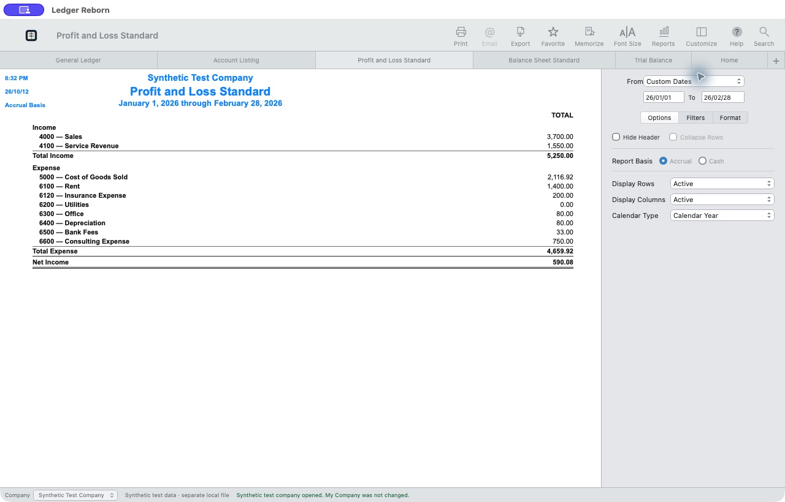

# Ledger Reborn

## PROJECT #000001 — REBUILDING PAID DESKTOP ACCOUNTING IN THE OPEN

**Real invoices, payments, inventory and bank reconciliation. A local SQLite ledger. A public plan to keep building.**

Maintained by [@lxistired](https://github.com/lxistired). [中文](README_zh.md) · [Downloads](https://github.com/lxistired/ledger-reborn/releases) · [Roadmap](ROADMAP.md) · [How REA helped](docs/CASE_STUDY.md)

We used [REA](https://github.com/morluto/rea) to investigate QuickBooks Desktop for Mac and independently implement a desktop accounting tool. The engine actually posts balanced journals, saves business documents, moves inventory and produces reports. This project is intended to continue as an open-source accounting application, with personal tax software as the next project in the series.

**Current release: `2026.10.12-preview.1`.** The number is a calendar version; the software is a preview. It does not reproduce every QuickBooks feature, has not passed full pixel/interaction equivalence, and is not affiliated with Intuit or REA. QuickBooks and TurboTax are referenced as comparison targets, not our product names.



## Try it

Download the asset for your platform from [Releases](https://github.com/lxistired/ledger-reborn/releases). Desktop builds bundle the Python runtime and open a dedicated application window. macOS packages use DMG; Windows packages provide a portable ZIP and, where built, a setup executable. Select the architecture shown in the filename.

These preview packages are not signed with an Apple Developer ID or a Windows publisher certificate. macOS notarization is not supplied in this release. Source and platform build recipes are available in this repository.

To run the browser edition from source, use Python 3.11 or newer:

```sh
python server.py
```

Open `http://127.0.0.1:8780`. Desktop development/build instructions are in [BUILDING.md](BUILDING.md).

Start with **My Company** for an empty ledger. The navigation menu can load **Synthetic Test Company** into its own database. The synthetic company is clearly labelled, and loading it does not replace My Company. No Intuit account, bank credentials or subscription are needed for the implemented local workflows.

## What works today

| Workflow | Implemented behavior |
| --- | --- |
| Journal entries | Balanced double-entry posting, linked audit trail, manual journal reversal, period locks |
| Customers and vendors | Persistent contact details and document-time snapshots |
| Invoices and bills | Service and inventory lines, dates, due dates, memos, balances |
| Receipts and bill payments | Partial payments and atomic allocation across selected documents |
| Inventory | Quantity/value tracking and moving weighted-average cost |
| Banking | CSV import, duplicate controls, match or classify, reconciliation with a zero-difference requirement |
| Reports | General ledger, P&L, balance sheet, trial balance, ageing, inventory, projects and budgets |
| Data ownership | Local SQLite files, database backup and JSON export |

The interface follows observed desktop workflows and layouts. Original screenshots, proprietary icons, vendor binaries, official sample databases and raw decompiler output are **not** shipped in the public source or application. The current artwork is original.

## Preview scope

One user, one local machine, USD. Payroll, tax filing, online bank connections, real payment execution, multicurrency, complete QuickBooks file migration, sales tax, credit memos, inventory returns and negative inventory are not implemented. Cash-basis output is a management cash view and has not been validated against all QuickBooks or tax rules. [Accounting policies](ENGINE_README.md) describe the current behavior.

## Evidence and reproducibility

Run the public accounting and HTTP tests:

```sh
python -m unittest discover -s tests -v
python tests/http_smoke.py
```

Synthetic inputs and expected cents are versioned in `fixtures/`. Expected amounts were frozen independently of the engine. Build workflows test the packaged local server as well as source code. Platform artifacts and checksums are attached to releases.

Our separate local investigation matched three original sample reports to the cent and measured selected UI screenshots. Those vendor sample files are not redistributed here. The public synthetic tests and the private original-software comparison have different scopes; see [the case study](docs/CASE_STUDY.md). No screenshot similarity score is presented as accounting correctness or complete compatibility.

## Follow the series

- **Project #000001: Ledger Reborn** — accounting, desktop distribution and public maintenance.
- **Project #000002: Personal Tax** — planned. A tax-year-specific calculation engine comes before filing integrations. No tax module is included in this release.

[Follow @lxistired](https://github.com/lxistired) for the next projects. [Star this repository](https://github.com/lxistired/ledger-reborn) to keep the accounting project handy, and use [Issues](https://github.com/lxistired/ledger-reborn/issues) for concrete bug reports or a workflow you want to help implement.

## Contributing

We intend to maintain the project in public through tested changes, versioned releases and a visible roadmap. Useful contributions include accounting edge cases, workflow fidelity, accessibility, packaging and migration tools. Start with [CONTRIBUTING.md](CONTRIBUTING.md). Security reports should avoid publishing customer ledgers; see [SECURITY.md](SECURITY.md).

Our authored code is MIT-licensed. Bundled third-party runtimes keep their own licenses. [REA](https://github.com/morluto/rea) is the investigation tool credited by this project, not a runtime dependency or an endorsement.
